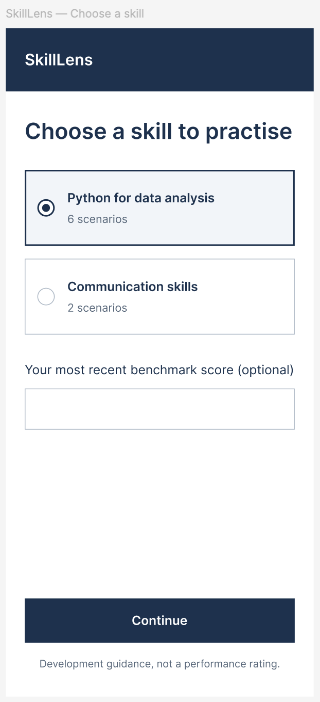
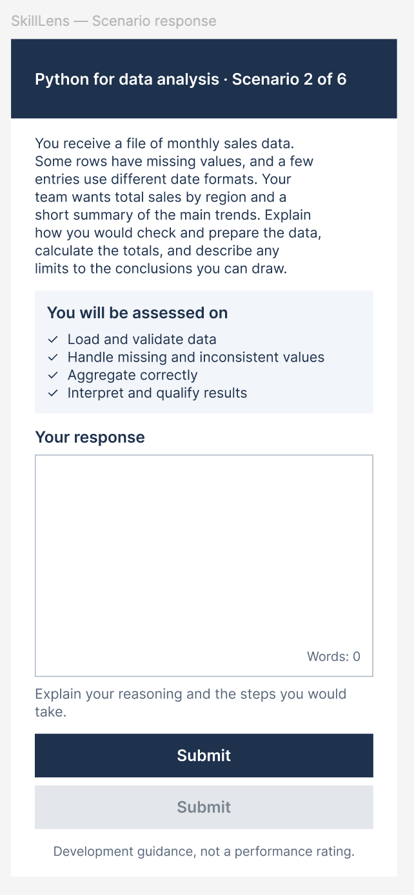
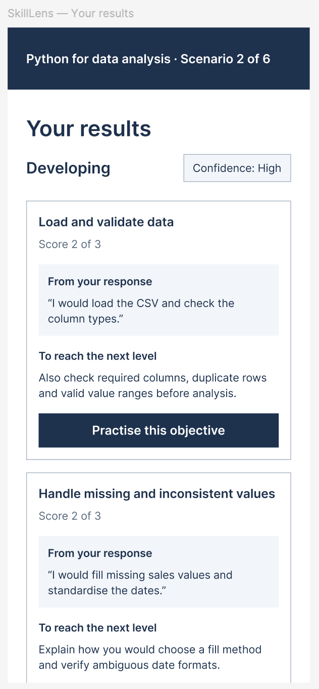
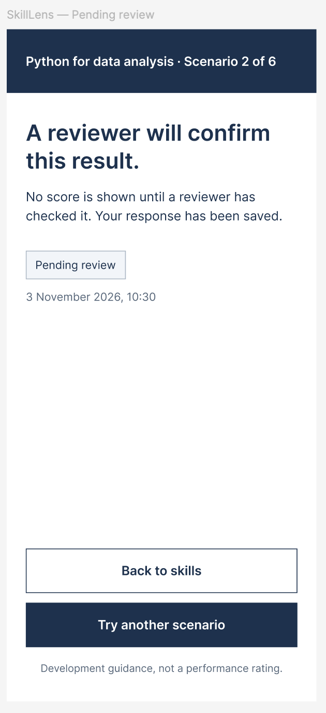
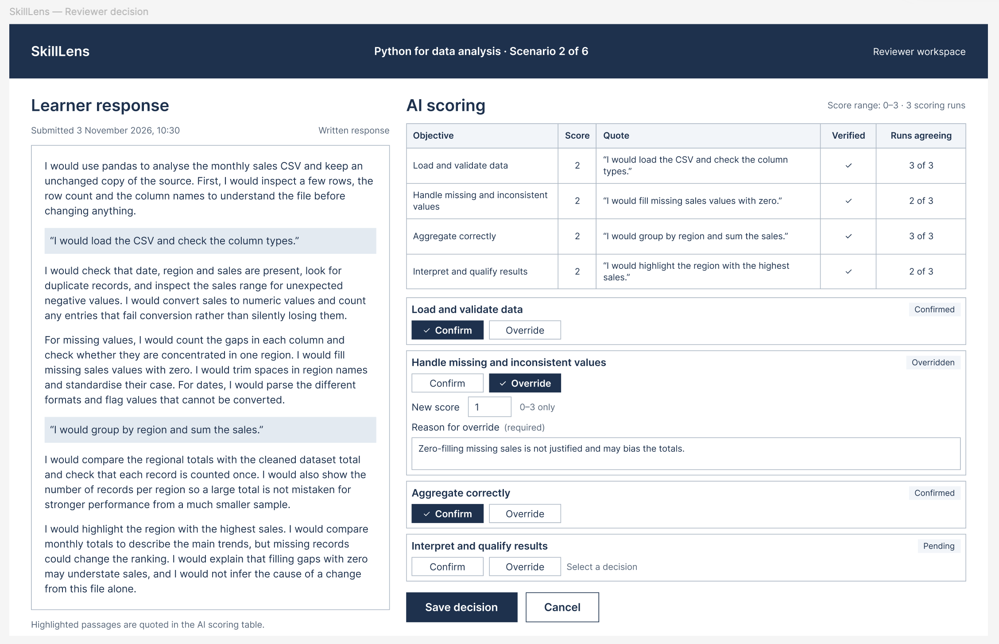
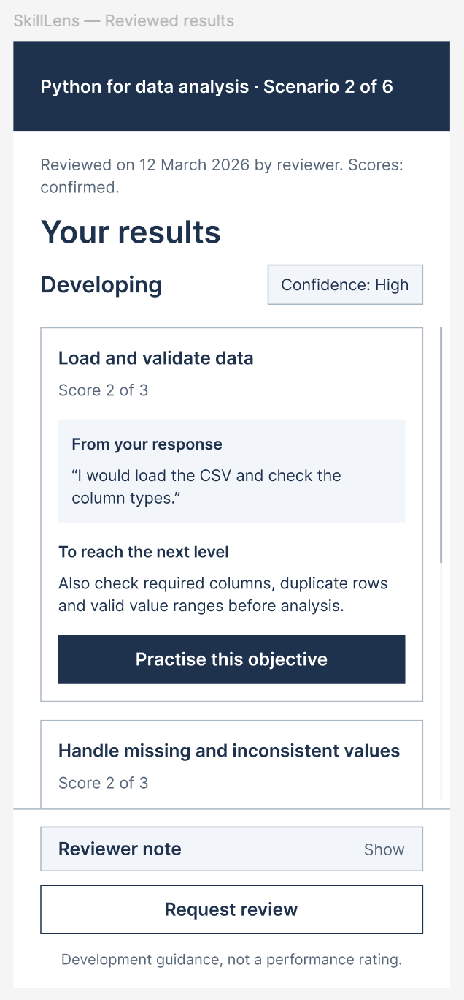
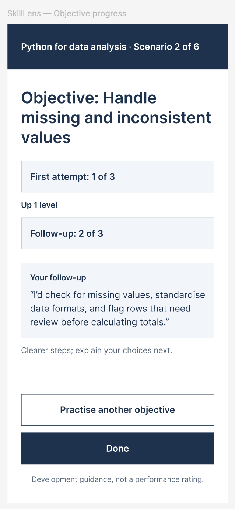

# SkillLens: UX, Workflow and Trust Design

This specification defines screens, states, content and behavior for the MVP. Each screen is shown as a wireframe image in this folder (`S0.png` to `S6.png`). The worked example is Python for data analysis. The same screens serve every skill; only the skill name, scenario, and objective list change.

---

## 1. Design Principles

1. **Review assistant, not an authority.** The product shows its reasoning and uncertainty. No score is shown without its supporting evidence.
2. **Development guidance, not a rating.** Every results screen states this.
3. **Human review where confidence is low.** The learner is always told what happens next. A result is never silently withheld.
4. **Evidence beside every score.** Quotations from the learner's own response appear next to each score.
5. **Plain language.** Labels and explanations are written for a non-specialist reader.

---

## 2. End-to-End Workflow

```
Select skill → Read scenario → Submit response
                                    │
                    Scoring (three runs) and checks
                    · quotations verified
                    · run agreement evaluated
                    · response length and relevance checked
                                    │
            ┌───────────────────────┴───────────────────────┐
     High or medium confidence                    Low confidence
            │                                             │
   Scores, evidence, feedback              Pending review (no score shown)
            │                                             │
   Optional follow-up scenario        Reviewer confirms or overrides (reason required)
   per objective below 3                                  │
            │                                 Reviewed result shown to learner
   Score change shown between attempts
```

---

## 3. Screen Inventory

| ID | Screen | Primary user | Purpose |
|---|---|---|---|
| S0 | Skill selection | Learner | Choose the skill to practise; see the skill's objectives |
| S1 | Scenario and response | Learner | Read the scenario; write and submit the response |
| S2 | Results and feedback | Learner | View per-objective scores, evidence, confidence and feedback |
| S3 | Pending review | Learner | Understand that a result is awaiting review |
| S4 | Reviewer queue and review | Reviewer | Confirm or override each objective score with a reason |
| S5 | Reviewed result | Learner | View the reviewed result and the reviewer's status note |
| S6 | Follow-up result and score change | Learner | View the result of a follow-up scenario on one objective, and the change from the first attempt |

---

## 4. Screen Specifications

### S0: Skill selection



- Header: product name.
- Skill list: name, number of scenarios, and short description. Skills without a published scenario set are not listed.
- Optional field: most recent benchmark score for the selected skill, entered by the learner. It is used for context only and does not affect scoring.
- Primary action: Continue.
- Footer: development-guidance statement.

### S1: Scenario and response



- Header: skill name, scenario number and total (for example, "Scenario 2 of 6").
- Scenario text: 6 to 10 lines of plain text.
- Objectives panel: the objectives this scenario assesses, listed by name. Shown before the response so the learner knows what is being assessed.
- Response field: free text, no formatting. A word count is visible.
- Guidance text: "Explain your reasoning and the steps you would take. Short answers will be asked to expand."
- Primary action: Submit. Disabled until at least one character is entered.
- Validation: responses under 40 words display a prompt to expand; submission is not blocked.

### S2: Results and feedback



- Overall band: a single band label for the attempt (for example, "Developing"), shown only when confidence is high.
- Confidence indicator: a single label for the attempt (High or Medium). Numeric confidence values are not shown.
- Objective cards, one per objective, with:
  - Objective name
  - Score (for example, "Score 2 of 3")
  - Evidence: the verbatim quotation from the learner's response, in a distinct style
  - Feedback: for objectives below 3, one line titled "To reach the next level", derived from the rubric descriptor for the next level
  - Action: "Practise this objective" for objectives below 3. This starts a follow-up scenario that tests only that objective (S6 shows the result).
- Method panel (expandable, labelled "How this result was produced"): a plain-language description of the process. It states that the result is AI-assisted, that quotations were checked against the response, and that a reviewer can be requested.
- Medium-confidence banner: "Some results were borderline. A second scenario would give a more reliable picture." Action: Try another scenario.
- Secondary action: Request review.
- Footer: development-guidance statement.

### S3: Pending review



- Heading: "A reviewer will confirm this result."
- Body: "No score is shown until a reviewer has checked it. Your response has been saved."
- Status: Pending review, with the date and time of submission.
- Actions: Return to skill selection; Try another scenario.
- No score, no objective breakdown, and no feedback are shown on this screen.

### S4: Reviewer queue and review



- Queue: pending items listed with skill, submission date, and reason for review (unverified evidence, run disagreement, or learner request).
- Review layout:
  - Left panel: the learner's response, with the cited quotations highlighted.
  - Right panel: AI scores per objective, quotations, verification status, and run agreement.
- Decision controls per objective: Confirm, or Override with a new score from 0 to 3.
- Reason field: required for any override. The reason is stored with the decision.
- Actions: Save decision. Status after save: Confirmed or Overridden.
- Reviewers cannot edit the learner's response.

### S5: Reviewed result



- Same layout as S2, with a status line: "Reviewed on [date] by [reviewer role]. Scores: confirmed" or "Scores: adjusted by reviewer."
- Reviewer's reason is shown only where the reviewer has marked it as shareable with the learner.

### S6: Follow-up result and score change



- Heading: the objective name.
- First attempt score and follow-up score, shown one above the other, with the change in levels (for example, "Up 1 level").
- The change is shown only when both attempts have high or medium confidence. Otherwise the follow-up result is shown with the message that a reviewer will confirm it.
- Evidence: the verbatim quotation from the follow-up response.
- Feedback: one line for the next level, if the score is still below 3.
- Actions: Practise another objective; Done.
- Footer: development-guidance statement.

---

## 5. Uncertainty and Fallback States

| State | Learner sees | System behavior |
|---|---|---|
| High confidence | Scores, evidence, feedback | Displays the result |
| Medium confidence | Scores with borderline banner and follow-up option | Displays the result; records the attempt for reliability analysis |
| Low confidence | Pending review screen | Holds the result; adds it to the reviewer queue |
| Unverified quotation | Same as low confidence | Holds the result; logs the failed quotation |
| Response under 40 words or off-topic | Prompt to expand the response | No scoring request is made |
| Scoring service unavailable | Message to retry shortly; the response is saved | Retries once automatically; does not display partial results |
| Follow-up scenario unavailable for an objective | Message that no follow-up is available yet for this objective | Offers another objective; does not affect the first result |

---

## 6. Trust and Explainability

| Element | Visible to the learner | Hidden from the learner |
|---|---|---|
| Development-guidance status | Yes, on every results screen | Not applicable |
| Method description | Yes, in the expandable method panel | Model name, prompt text, and technical parameters |
| Evidence | Yes, verbatim quotations | Raw model output |
| Confidence | Level label (High, Medium) | Numeric values |
| Review status | Yes, with date and reviewer role | Reviewer's identity |
| Reason for withheld result | Plain-language reason on S3 | Internal thresholds |

---

## 7. Human-in-the-Loop

- **Entry points for review:** low-confidence results; unverified quotations; learner request on any result.
- **Reviewer actions:** confirm each objective score; override any objective score with a required reason.
- **Reviewer limits in the MVP:** cannot edit the learner's response; cannot see other learners' results; cannot export data.
- **Escalation:** where the same objective is overridden repeatedly, the rubric is flagged to the content owner for review.

---

## 8. Accessibility and Content Standards

- All functions are available by keyboard.
- Text contrast meets WCAG 2.1 AA.
- Confidence and score levels are shown as text as well as colour.
- Scenario and result text is written at a reading level suitable for professional adults.
- Quotations are shown in a distinct style and are identified as the learner's own words.

---

## 9. Key Journeys

**Journey A: High confidence.** The learner selects the skill, reads the scenario, submits a response, and receives scores, evidence and feedback. For an objective below 3, the learner takes a follow-up scenario on that objective and sees the score change (S6).

**Journey B: Low confidence.** The learner submits a response and sees the pending review screen. A reviewer confirms or overrides the scores. The learner then sees the reviewed result with the reviewer's status line.

**Journey C: Medium confidence.** The learner receives results with the borderline banner, selects another scenario, and completes it.
